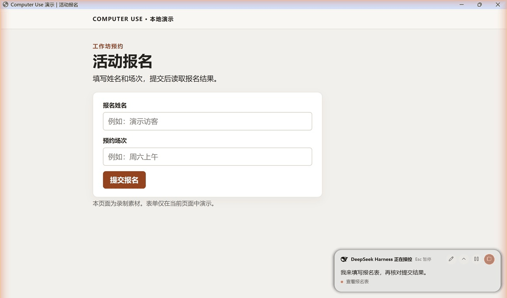

# dsh-computer-use

在 DeepSeek Harness 里交代一个任务，让模型用你已经安装的 Windows 应用完成它。它可以打开应用、读界面、点击和输入，也可以在操作后检查结果。你可以在屏幕上看着它做，随时暂停或接手。

> **可以这样说**：「打开记事本，把下面三条待办写进去，保存到桌面，最后告诉我文件名。」

*演示中，插件按控件名填写报名表，中途暂停，继续后提交并读出确认文字。画面取自隔离 Chrome 配置中的实际操作，动作由脚本发起，卡片使用演示文案。*

## 可以用它做什么

| 场景 | 可以交给 DSH 的任务 |
| --- | --- |
| 浏览器 | 用当前已打开的 Chrome，在同一窗口的新标签打开网址，填写表单并检查确认提示。 |
| 办公软件 | 在 Word、WPS 或记事本中输入和整理内容，按指定位置保存，再确认文件名。 |
| 桌面应用 | 打开计算器、文件资源管理器等应用，操作菜单或对话框，再读出屏幕上的结果。 |

## 一次操作是怎么完成的

- **先看清界面。** 模型可以读截图，也可以通过 Windows UI Automation 获取按钮、输入框及其内容。例如，直接定位「按钮:提交报名」；同名控件还能用 AutomationId 区分。截图上的坐标由插件换算，适配 Windows 的缩放和多显示器。
- **连续完成几步。** 「填字段 → 提交 → 等成功提示」可以放进同一个批次。等待条件满足就继续，结束时等画面稳定再回传截图，也可以只读出窗口文字。
- **处理常用应用时参考操作笔记。** 插件内置 Word、Excel、Chrome 等应用的技能，模型打开对应应用时会收到常用快捷键和操作步骤。你可以在设置页查看或编辑这些笔记。

## 操控期间，你仍然掌握主动权

默认按应用授权，DSH 会在需要时请求操作目标应用。开始操控后，橙色光晕标出操控状态，迷你卡片上方显示 DSH 提供的思考内容，下方保留操作时间线。按 **Esc** 暂停或继续，点 **停止** 结束本轮。你也可以直接在卡片上输入新指令，或者亲自接手键盘。

正文一开始输出，就回到 DSH 对话阅读。桌面版会恢复窗口并切回前台，Web GUI 会尝试回到任务开始时识别到的活动 DSH 标签。可查看[暂停时的卡片](assets/demo-paused.png)和[任务结束的画面](assets/demo-complete.png)。授权范围、截图和剪贴板的处理规则见[数据与权限](docs/privacy.md)。

## 安装并试一次

需要 **Windows 10 2004+ 或 Windows 11**，以及 **DeepSeek Harness 0.2.0-rc.2 或更新版本**。在 DSH 桌面版的 **插件 → 添加插件** 中输入 `@copylee/dsh-computer-use`，安装后启用。

第一次可以试试「打开计算器，算 1234 × 5678，然后读出结果」。支持图片输入的模型可以看截图；纯文本模型可以读取应用提供的无障碍控件和窗口文字。游戏、画布和部分自绘界面可能需要截图定位。Web GUI 安装方式和常见问题见[安装与排障](docs/getting-started.md)。

## 文档

| 文档 | 内容 |
| --- | --- |
| [安装与排障](docs/getting-started.md) | 桌面版与 Web 安装、第一次操作和常见问题 |
| [操作指南](docs/usage.md) | 示例任务、授权、暂停与接管、应用技能 |
| [设置参考](docs/settings.md) | 截图、输入方式、浮层和 Web GUI 地址 |
| [Agent 工具](docs/tools.md) | 工具清单、控件定位、批量动作与文字结果 |
| [数据与权限](docs/privacy.md) | 模型可见数据、截图缓存、剪贴板与 Windows 限制 |
| [开发与验证](docs/development.md) | 架构、构建、Windows 冒烟测试和本地联调 |

[MIT License](LICENSE)
