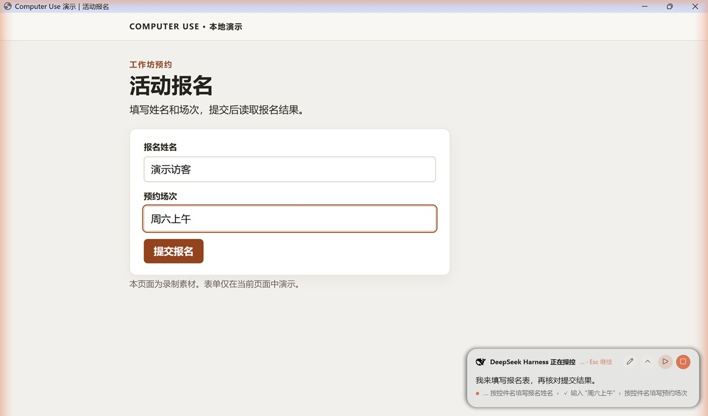

# 操作指南

[返回功能介绍](../README.md) · [安装与排障](getting-started.md) · [Agent 工具](tools.md)

## 给出任务和完成条件

可以直接用自然语言说明要做的事。指定应用、目标和完成后的检查项，便于模型知道什么时候停下。

- “打开记事本，写三条项目待办，保存到桌面，最后确认文件名。”
- “用计算器算 1234 × 5678，读出显示的结果。”
- “用浏览器打开这个网址，找到活动说明并提取报名时间。”

在默认的按应用授权模式下，DSH 会提示你批准目标应用。会话权限设为完全权限或自动审查且无需询问时，应用请求可能自动批准。DSH 自身和禁用列表仍受保护。

## 看进度和接管

| 操作 | 效果 |
| --- | --- |
| **Esc** | 暂停。再按一次继续当前任务。 |
| **停止** | 结束本轮电脑操控。 |
| **展开** | 展开迷你卡片，查看更多回复和最近操作。 |
| **输入** | 暂停后插入指令。按 Enter 发送，按 Esc 取消。 |
| 亲自打字或切换窗口 | 打字时等待你停手。切换到新窗口后，模型会先重新查看画面。 |

卡片可以拖动，支持系统深浅色。光晕和卡片供你查看，常规的模型截图会避开这些覆盖层。任务结束时，迷你卡片会短暂显示完成状态。模型长时间未继续操控时，覆盖层会收起，直到下次电脑操作。

## 应用技能

插件可保存某个应用的操作笔记，如快捷键或常用菜单。模型用 `open_application` 打开应用时，会收到对应的笔记；可在 **设置 → 电脑控制 → 应用技能** 查看、编辑、创建或恢复默认内容。

内置技能覆盖 Word、PowerPoint、Excel、Chrome、文件资源管理器、Obsidian、Typora、微信、QQ 和记事本。自行添加的内容存放在 `~/.dsh/computer-use-skills/`，与内置内容分开保存。
